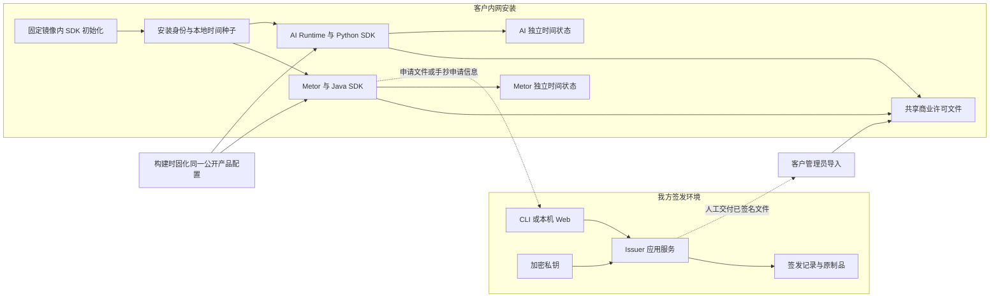
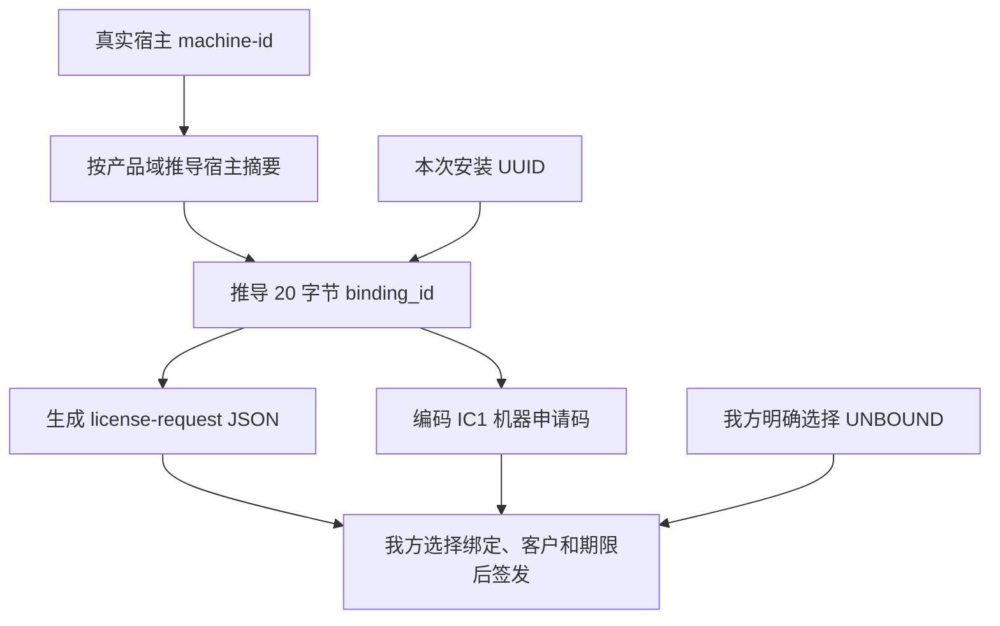
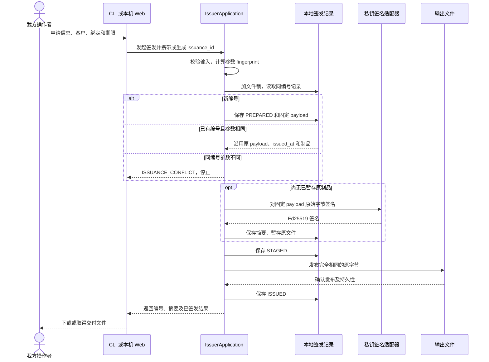
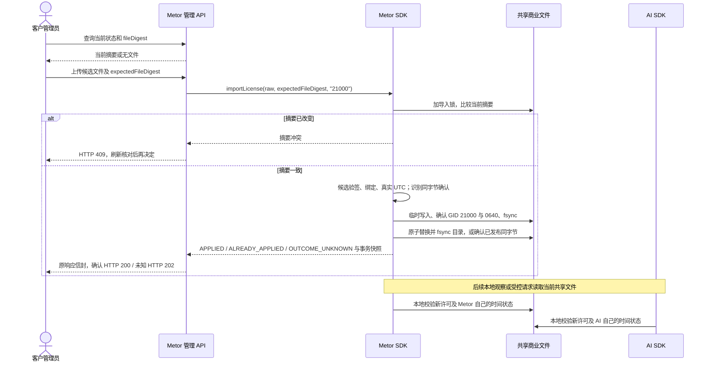
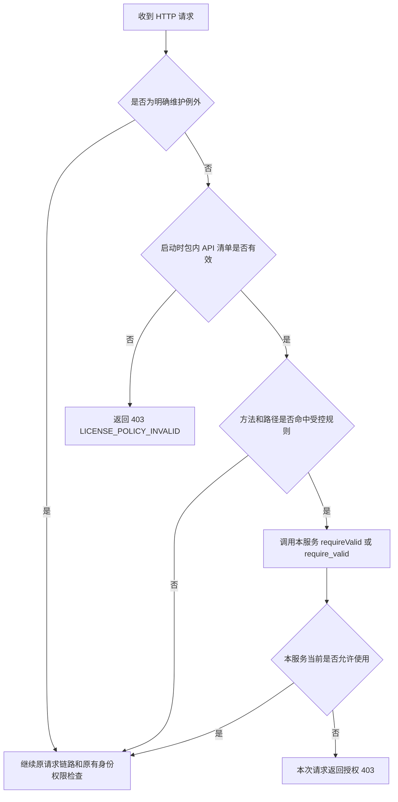
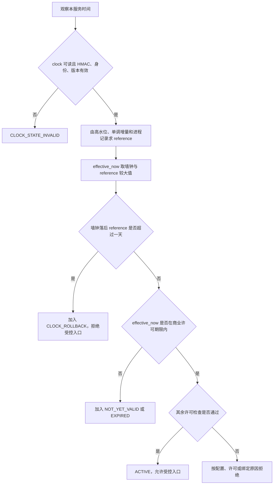
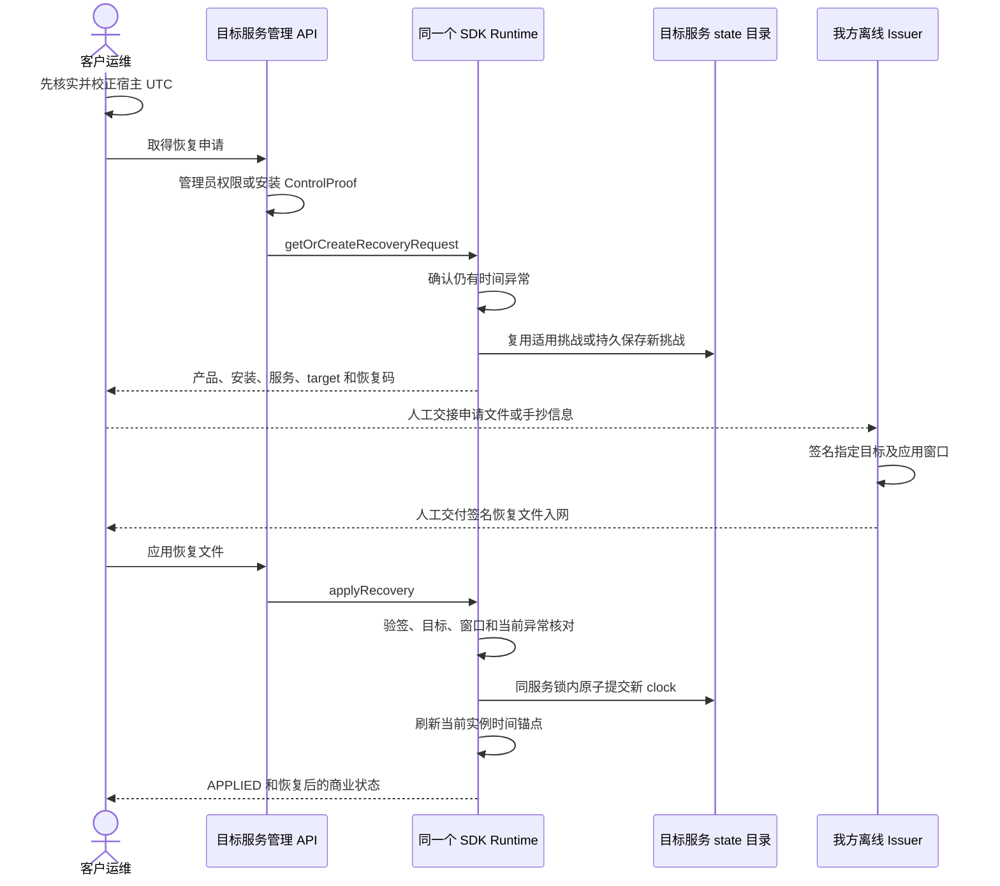
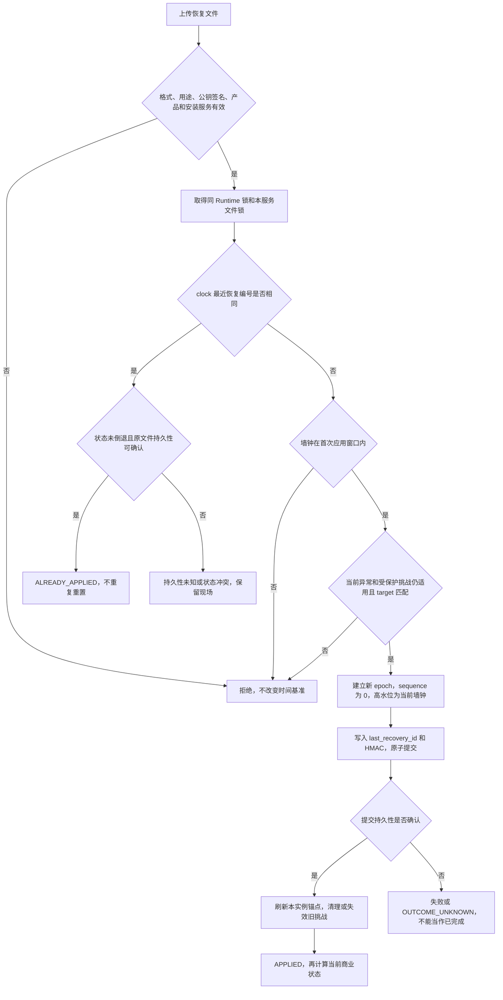

# 离线授权机制实现逻辑

本文解释 SDK **0.7.1** 下产品的机器范围和使用时间控制，Issuer 当前为 **0.4.0**，继续使用 v1 商业与恢复协议。
初始化、申请、商业导入、checkpoint、时间 HMAC 与恢复事务全部复用 SDK；图中的协议算法用于解释 SDK 行为，不是在产品或部署脚本中重写的实现。

原文历史基线是 2026-10-23：SDK `39a2c2e`、Issuer `95f87cf`、Metor `db221a2`、AI Runtime `b2675e3`。
当前 SDK 发行提交为 `dcfd8abc08b8b78d3fe47f40a8dac24e80093032`；产品迁移制品和平台结果另见 [SDK 升级手册](license-sdk-upgrade.md)。
操作以[首次安装／升级](license-sdk-upgrade.md)、[当前恢复手册](license-recovery.md)和 [Issuer 中文说明](../../license-issuer/README_cn.md)为准，旧实操文档仅作历史参考。

## 1. 整体结构：我方签名，客户本地校验

我方把客户、产品、机器绑定和期限写入许可载荷，用 Ed25519 私钥签名。客户服务只持有对应公钥，在本地验证签名、安装绑定和有效时间。许可文件可通过人工方式送入内网，运行和恢复均不依赖公网授权服务器。



图中的公开配置由本产品 Issuer 导出为 `license-product.json`，Java、Python 和安装工具使用同一原始字节，构建元数据 schema 2 固定其 SHA256。
产品调用 SDK factory 装配指定服务；不再另收一份 DER 公钥表。许可上传不会提供信任，客户不能通过运行环境变量更换公钥或关闭客户发行模式。

各组件职责如下：

| 组件 | 负责什么 | 重要边界 |
| --- | --- | --- |
| `license-issuer` | 密钥生成、商业签发、恢复签发、签发记录和原文件保留 | 仅在我方运行，不进入客户制品 |
| 通用 SDK | 初始化／只读安装核验、申请、严格解析、验签、绑定／期限判定、共享导入事务、时间保护与恢复、checkpoint 生命周期 | 不持有商业私钥，不分配 ICP UID/GID 或维护业务队列 |
| 产品接入层 | 固化公开配置及 API 清单、SDK factory、请求与固定入口 guard、原管理 API／账号权限／审计 | 管理和业务接口委托同一长期 Runtime，不保留第二套写入事务或定时器 |
| 部署工具 | 固定镜像断网调用 SDK，检查路径与宿主 ID 占用、落实目录权限、归档与恢复 | 宿主不安装 SDK，不编码 seed／HMAC；应用启动不补造丢失资料 |

两服务读取**同一份商业 License**；它们分别校验，不需要互相请求授权状态。Metor 校验通过不替代 AI 校验。若一次业务请求会正常调用 AI，两处入口都可能检查，但不存在额外的联合许可协议。

## 2. 文件和编号分别表示什么

### 2.1 客户安装中的物理文件

宿主机授权根目录由 `LICENSE_ROOT` 指定，典型值是 `/opt/icp-diag/runtime/license`；容器内统一映射到 `/run/icp-license`。

```text
<LICENSE_ROOT>/
├── identity/
│   ├── installation.json        安装 UUID、产品和初始化完成标记
│   └── service.key              32 字节安装主密钥；不是我方签发私钥
├── shared/
│   └── active.license.json      两服务共同读取的商业许可
└── state/
    ├── metor/
    │   ├── clock.json          Metor 的 HMAC 时间状态
    │   └── recovery-challenge.json  按需创建的 Metor 恢复挑战
    └── ai/
        ├── clock.json          AI 的 HMAC 时间状态
        └── recovery-challenge.json  按需创建的 AI 恢复挑战
```

运行时还会创建用于串行化写入的锁文件；锁文件不是许可，也不是机器身份。真实宿主 `/etc/machine-id` 另行只读映射为 `/run/icp-host/machine-id`，不位于上述授权根目录。

制作方提供正式 SDK 与公开配置；客户执行 `license-init` 后，由镜像内 SDK 生成 identity／key／clock，不需要手搓文件。
商业许可由 Issuer 签发，Metor 通过 SDK 发布；恢复挑战只在取得恢复申请时按需生成。镜像须先导入，才能执行安装工具。
备份在停止写入后调用 SDK 公开 `validate_installation` 做完整资料只读核验，不创建 Runtime、不读取商业状态来推断安装完整性，不改 clock、锁或挑战。

两服务均只读安装身份；Metor 可以发布共享商业许可，AI 只读；每个服务只读写自己的 state 目录。`service.key` 用于派生本地状态 HMAC 和维护凭据，不具备生成商业签名的能力。

### 2.2 不要混用的编号和文件

| 名称 | 实际含义 |
| --- | --- |
| `installation_id` | 这次安装的 UUID；参与机器绑定，也用于定位恢复目标 |
| `binding_id` / `IC1-...` | 宿主标识与安装 UUID 的派生摘要，以及它的可手抄编码 |
| `key_id` | 从产品已配置的可信公钥集合中选取公钥的标识，不是私钥口令 |
| `issuance_id` | 我方一次签发操作的幂等编号；当前商业载荷中也作为 `license_id`，恢复载荷中作为 `recovery_id` |
| `RC1J-...` / `RC1A-...` | Metor / AI 当前异常的恢复目标编码，不是商业机器申请码 |
| 商业许可文件 | 允许指定产品在签名约定的绑定、期限内使用 |
| 恢复文件 | 允许指定安装、指定服务、指定异常目标在指定窗口内重建时间状态 |

## 3. 机器申请和 License 生成逻辑

### 3.1 先初始化安装，再生成机器申请

部署工具在固定的新 AI 镜像内调用 SDK `initialize_installation`；SDK 首次生成安装 UUID v4、随机 `service.key` 和两个服务的初始时间状态，最后发布完成身份。
部署代码只处理受审路径、数值 UID/GID 与权限，不自己生成或验证 HMAC。完整安装重复调用保留同一身份、key 和 clock；完成后缺件会拒绝，而不是补造。
普通应用启动不会把丢失的 clock 当作“首次运行”重新生成，旧安装器遗留 stage 也不自动迁移。

产品调用 SDK `commercialRequest`／`commercial_request` 生成申请，不自己拼装 JSON 或机器码。SDK 用真实宿主 machine-id 和安装 UUID 推导绑定摘要：

```text
fingerprint = HMAC-SHA256(
    key = 产品固定 fingerprint_domain,
    message = machine-id 的 16 字节值
)

binding_id = SHA256(
    产品固定 binding_domain || 0x00 || fingerprint || 安装 UUID 的 16 字节值
)[前 20 字节]
```

这里的 domain 是公开的产品协议常量，用于隔离用途，不是商业签发秘密。`binding_id` 输出为 40 位小写十六进制；IC1 是这 20 字节的带校验编码。校验信息用于发现抄写错误，不能证明申请经过我方授权。



绑定许可需要申请文件或 IC1 二选一。禁止文件出网时可以抄机器码；允许文件入网即可交付签名结果。无绑定签发不需要机器申请，客户无法读取 machine-id 时仍可导入合法的无绑定许可。

同一宿主重新初始化安装会得到新 UUID，绑定随之变化；换机或重装按新申请重新签发，不设计迁机和旧许可撤销流程。两服务使用相同产品域、宿主标识和安装 UUID，因而能验证同一绑定许可。

### 3.2 许可载荷和签名文件

商业载荷包含 `schema_version`、`kind`、`key_id`、`license_id`、客户标识与名称、`product_id`、绑定字段、期限字段和 `issued_at`。四种组合互相独立：

| 绑定 | 期限 | 核验行为 |
| --- | --- | --- |
| `HOST_INSTALL` | `TERM` | 验证本安装绑定及起止时间 |
| `HOST_INSTALL` | `PERPETUAL` | 验证本安装绑定、生效时间；`expires_at` 为 null |
| `UNBOUND` | `TERM` | 不要求机器摘要匹配，但仍检查起止时间 |
| `UNBOUND` | `PERPETUAL` | 不绑定机器、无到期日；仍验证签名、产品、生效时间和运行时完整性 |

无限期、无绑定均不表示停用 SDK。客户发行模式 `CUSTOMER_REQUIRED` 仍要求正常校验。`DEVELOPMENT` 是独立构建模式，不是客户可通过运行配置打开的开关。

签发文件的外层结构为：

```json
{
  "payload": "载荷原始字节的无填充 Base64URL",
  "signature": "Ed25519 签名的无填充 Base64URL"
}
```

issuer 将载荷序列化为确定的 JSON 字节，用私钥签名，再封装文件。SDK 验证的是**解码出的原始载荷字节**，不会先重新序列化再验签。Base64URL 是编码，不是加密；文件内容可读，但修改签名覆盖的字段会导致验签失败。

## 4. 签发逻辑：先固定这次操作，再生成和发布原文件

CLI 与本机 Web 调用同一个 `IssuerApplication`，不实现两套签名规则。Web 负责输入、预览和编号管理；最终确认后复用应用层签发逻辑。

首次建立信任时，`keygen` 随机生成 Ed25519 密钥对，把私钥保存为口令加密的 PKCS#8、公钥保存为 SPKI。公钥和同一 key ID 作为产品构建输入；后续日常签发复用这套密钥，不是每份 License 都新建密钥。只在签发端换密钥而未更新客户产品信任，客户会拒绝新文件。



图中成功路径只有在发布和记录均确认后才返回完成；某一步异常时保留原编号和现场。`fingerprint` 是签发参数摘要，与机器 `fingerprint`、最终文件摘要分别使用，不能混为一谈。

`issuance_id` 解决“响应丢失后再操作，是继续同一次签发还是另签一份”的问题。当前 CLI 可不传该参数，由入口自动生成 UUID；失败后使用输出中提示的原编号和原参数重试。Web 自动保存并复用编号，无需人工生成 UUID。

重试复用原载荷和 `issued_at`，已有原文件时复用原字节，不延长期限或恢复窗口。换参数复用同编号会冲突；明确续签是新编号、新许可。历史重新下载只取原文件，不重新签名。输出路径已有不同内容时不会覆盖，这可能产生 `OUTPUT_FAILED`，不代表私钥签名失败。

签发记录目录保存 `<issuance_id>.json` 和 `<issuance_id>.artifact`，分别是操作记录与原制品；下载/输出目录保存对外交付文件。三者和我方私钥均留在我方，客户只接收签名结果。

## 5. 导入、续期与两服务如何看到新许可

正常导入通过 Metor 管理页面/API 完成：管理员上传商业文件，产品调用同一 SDK Runtime 的导入接口，SDK 完成核验和共享发布。
前端不直接写宿主文件，也不向 AI 推送许可；产品不另有商业文件 CAS／rename 实现。



`expectedFileDigest` 是防并发覆盖的 CAS 条件：页面读取的版本已改变，就拒绝用旧认知覆盖他人刚导入的文件。首次无文件的请求使用 `NONE`。文件摘要是完整外层文件的 SHA-256；`payloadDigest` 是载荷字节的摘要，不能互换。

候选预检使用真实墙钟 UTC，不修改当前商业文件或时间状态。因此“新文件允许导入”和“导入后当前服务可以使用”是两个结果：存在回拨/时间状态损坏时，即使新商业许可导入成功，受控入口也可能继续拒绝。

SDK 确认首次写入后返回 `APPLIED`，同字节确认返回 `ALREADY_APPLIED`；过期许可的同字节确认不会续期，当前状态仍为 EXPIRED。
共享组及 `0640` 在原子替换前就已落实，不存在发布后再 chmod／chgrp 的读取窗口。产品响应直接使用 SDK 事务快照，避免再次读取时被另一个导入覆盖；
摘要读取失败报告存储错误，不将其冒充为无文件。已发布但持久性未确认时返回 `OUTCOME_UNKNOWN`／HTTP 202，先刷新并用同一文件重试核对。
商业导入不写 clock，不改变 `epoch`，也不恢复另一个服务。

正常安装、续期及重复确认统一使用管理入口获得 SDK 预检、CAS 与持久性结果，不手工覆盖共享文件。
时间恢复文件必须走恢复 API，不能复制为 `active.license.json`。

## 6. 请求链路上的授权核验

### 6.1 只拦关键入口，不管理业务生命周期



“维护例外”只绕过 License 拦截；登录、管理员权限和 AI 安装 ControlProof 仍由各自入口验证，不意味着这些 API 可匿名调用。

SDK 核验包含以下内容：

1. 安装身份、客户构建模式和信任配置可用。
2. 时间状态可读、HMAC 和所属产品/安装/服务匹配，未检测到状态倒退或明显时间回拨。
3. 商业文件严格解析：大小、字段、类型、编码、日期均合法，拒绝重复或未知字段等异常输入。
4. 载荷用途为 `commercial-license`，产品匹配，`key_id` 属于构建信任，Ed25519 签名有效。
5. `HOST_INSTALL` 重新从本机计算 binding 并匹配；`UNBOUND` 不访问机器标识来做绑定比较。
6. 用 SDK 的 `effective_now` 判断期限：`not_before <= effective_now < expires_at`；无限期只省略上界。

上述步骤是逻辑检查项；实现会收集多个原因并按优先级选取主状态，不是“上一行错误以后就一定不再观察其他项”。例如错机和坏签名均可归并为 `INVALID`；回拨还可能同时伴随 `EXPIRED`。查问题时同时看 `state` 与 `reasons`。

默认受控清单涵盖 Metor 单据创建/上传、报告生成/导出，以及 AI 场景调用/测试、知识检索和部分索引写入等关键接口。确切方法和路径以[Metor 包内清单](../../metor-service/metor-app/src/main/resources/META-INF/metor-license-routes.json)和[AI 包内清单](../../ai-runtime-service/app/license-routes.json)为准。

另外保留两个固定关键方法入口：Metor `TicketService.create()` 与 AI `InvocationService.invoke()` 在首行调用同一个 guard，避免内部调用绕过 HTTP 规则。这是少量入口保护，不加入业务状态机。

通过即继续；失败只拒绝本次入口。已有执行没有新增的 License 中途撤回、租约、排队、续接或自动重试流程，用户登录及原账号权限也不会因 License 拒绝而被注销。

### 6.2 为什么清空 API 配置不能直接放行

受控清单位于发行包内部，其 SHA-256 固定在构建元数据中。服务**启动时验证并加载一次**：文件缺失、为空、被替换、摘要不符或结构非法，策略都无效；不是“空规则等于全部放行”。策略无效时非维护请求受限，固定关键方法也拒绝。

运行中不重新加载该清单；改变磁盘文件不会清空已加载规则。下次启动时，修改后的清单会被拒绝。恢复正确发行资源并重启可修复策略问题；时间恢复文件只修复时间状态。

## 7. 防时间回拨：三个时间共同决定当前有效时间

### 7.1 不能只比较系统时间和到期日

只用墙钟执行 `系统时间 < 到期日`，把系统日期改早就可能延长使用。SDK 因此同时使用：

| 量 | 含义 | 是否跨进程保留 |
| --- | --- | --- |
| `wall_now` | 操作系统当前 UTC，可以被运维调节 | 系统提供 |
| `high_watermark` | 已确认的有效时间高水位，保存在 HMAC clock 中 | 是 |
| 单调时钟增量 | 当前进程经过的时间，不随系统日期向前/向后调整 | 否；重启建立新锚点 |
| 进程已观察的有效时间 | 防止本进程内已经看到的时间再后退 | 否；检查点持久化后由高水位接力 |

首次观察建立 `anchor = max(wall_now, persisted_high_watermark)` 和单调时钟起点。两端实现可概括为：

```text
reference = max(
    已保存的 high_watermark,
    anchor + 当前进程单调时钟经过的时长,
    当前进程已保留的有效时间
)

effective_now = max(wall_now, reference)

明显回拨 = wall_now + 86,400 秒 < reference
```

等于一天不因回拨本身拒绝，超过一天才触发 `CLOCK_ROLLBACK`。**容差不把 effective_now 向后减一天，也不让许可提前生效或延后到期。** 到期边界仍是到期瞬间不可用，没有 24 小时商业宽限。



受控请求和产品状态查询调用 SDK 的观察接口，每次判断当前时间与许可，不逐请求强制写 clock。
应用生命周期仅调用 SDK `start()`／`close()`，由 SDK 自己的 worker 约每 30 秒保存检查点；产品不维护第二个 Spring 定时器或 asyncio 循环，也不在关闭时额外强制 checkpoint。
即使没有业务请求，运行中的服务仍推进检查点。正常检查点增加 `sequence`，不降低高水位；回拨期间不以较早墙钟覆盖高水位。

这里的运行时观察不等同于备份安装核验：观察仍判断有效时间，不能用它替代 SDK 完全不写入的 `validate_installation`。
后者只核对完整身份、主密钥和全部配置服务的 clock/HMAC，不判断商业许可是否存在或过期，也不推进时间。

### 7.2 调时间后具体会发生什么

假设所有日期均为 UTC，许可于 2026-11-01 00:00 到期：

| 操作 | SDK 观察与结果 |
| --- | --- |
| 10 月 23 日正常使用后，把系统改为 2 月 1 日 | 2 月明显落后已观察参考时间超过一天，触发 `CLOCK_ROLLBACK`；受控请求被拒绝，不能因此获得额外八个月 |
| 进程持续运行，把墙钟调早 12 小时 | 容差内可不报回拨；有效时间仍由原锚点和单调时钟推进，不能把到期点向后平移 12 小时 |
| 已观察到 11 月 1 日到期，再把墙钟改早几小时 | 若当前进程记录或持久高水位已到到期点，`effective_now` 不后退，仍为到期；超过一天还可能同时报回拨 |
| 把时间误调到 12 月并被观察，再校正回 10 月 | 未来值可能已成为进程参考或持久高水位；校正后仍可能明显回拨，需要签名恢复允许重建基准 |
| 重启后墙钟明显早于保存的 clock 高水位 | 新进程仍读到旧高水位，继续触发回拨；重启不是删除高水位 |

仅由正常墙钟被调早引起的 `CLOCK_ROLLBACK`，在墙钟校正到足够接近参考时间后可能自动解除；此时取得申请会返回“无需恢复”。签名恢复主要用于校正后仍有异常的情形，以及缺失/损坏的时间状态。`CLOCK_STATE_INVALID` 在当前实例可保持受限，不能承诺手工换回文件就能即时解除。

### 7.3 时间状态如何保护

`clock.json` 也是外层封装，但使用 `payload + mac`，不是商业许可的 Ed25519 `payload + signature`。本地安装主密钥按产品和服务用途派生 HMAC-SHA256 密钥，保护以下信息：

| 字段 | 用途 |
| --- | --- |
| 产品、安装 UUID、服务 | 防止把别的安装或 AI 的 clock 当作 Metor clock |
| `epoch` | 时间基准代数；仅受控恢复建立新一代基准 |
| `sequence` | 同一代正常检查点递增；检测本进程已见状态的倒退 |
| `high_watermark` | 保存有效时间高水位，重启后继续作为参考 |
| `last_recovery_id` | 标识最近一次已完成恢复，识别同文件重试 |

文件缺失、损坏、MAC 不匹配、身份不符，以及运行中观察到 epoch 异常变化、序号/高水位倒退等，会导致时间状态受限。普通许可替换没有写这些字段的权限路径，所以续期不能顺便清除回拨。

## 8. 时间恢复：我方授权重建一个服务的时间基准

### 8.1 操作闭环与联网边界



“取得申请”仅访问内网目标服务和它自己的文件系统，不访问我方服务或互联网。我方可以离线签发。申请无法导出时，抄写产品、安装 UUID、服务和 RC1J/RC1A 码即可；客户需要允许最终恢复文件入网。

Metor 使用平台管理员权限；AI 维护客户端使用安装派生的短期 ControlProof，直接调用 AI，不经过 Metor。它是维护 API 的身份凭据，不是商业许可，也不替代 Ed25519 恢复签名。

### 8.2 申请为何与“这一次异常”绑定

只有当前 `reasons` 包含 `CLOCK_ROLLBACK` 或 `CLOCK_STATE_INVALID`，才能取得恢复申请。普通商业到期、尚未生效或没有许可，本身都不是恢复理由；若同时存在时间异常，则可针对时间部分恢复。

Runtime 对当前 clock 原始字节求 `state_identity`；文件缺失时使用固定缺失标记的摘要。随后生成随机 nonce，并派生：

```text
target_id = SHA256(
    产品恢复域 || 0x00 || 安装 UUID || 服务名 || 0x00
    || nonce || state_identity
)[前 20 字节]
```

target 编码为 RC1J 或 RC1A。完整挑战还保存异常原因、`base_epoch`、生成时间，并用本安装派生 HMAC 保护在 `recovery-challenge.json` 中。既有挑战的安装、clock 摘要和基准仍适用时复用，重复点击或重启不会任意换码。

申请不等于我方批准。issuer 对申请做格式和内部一致性核对，最终是否给这个客户恢复仍由我方操作者决定。SDK 应用恢复时，还要与客户本地受保护的当前挑战匹配，单独伪造一段申请信息不会自动恢复客户实例。

### 8.3 恢复文件签了什么

恢复载荷的用途是 `clock-recovery`，包含产品、可信 `key_id`、安装 UUID、目标服务、`recovery_id`、`target_id`、签发时间和应用窗口，再使用我方 Ed25519 私钥签名。它不含新的商业到期时间。

时间约束为：

```text
issued_at <= window_start < window_end <= issued_at + 7 天

首次应用要求：window_start <= 已校正的 wall_now < window_end
```

窗口表示**客户什么时候能应用该恢复文件**，不是操作者必须在什么时候运行签发命令。当前 Web 在最终首次确认时设为立即生效、默认七天；CLI 显式填写窗口。窗口起点可等于签发时间，不要求严格晚于，但不能早于它。恢复窗口精确判断，不使用一天回拨容差，也不用已被未来高水位影响的 `effective_now` 来判断。

### 8.4 应用时如何防止误用、重复恢复



正常状态更新不能降低高水位；**经过我方签名批准且匹配本次异常的恢复**，才允许用当前已校正墙钟建立新一代基准。可用旧 epoch 时推进为下一代；无法取得有效旧 epoch 时按初始恢复代建立。新状态设置 `sequence = 0` 和 `last_recovery_id`，用本地 HMAC 保护后原子提交。

提交后，同一个 Runtime 同步刷新进程锚点、单调时钟起点和错误状态；所以无需重启，也不会继续沿用内存中误记到未来的参考时间。API 层不直接写 clock，不需要另一个组件通知 Runtime 重载。

同一恢复编号已记录时，先验证签名、身份及已提交状态，再确认持久性，返回 `ALREADY_APPLIED`；这个确认分支可以在窗口结束后运行，但不会再次降低高水位或增加 epoch。因此旧文件的重复提交是“确认那次已完成”，不是重复给机器重置时间。新的异常需要取得新的适用挑战并重新签发。

恢复仅作用于本服务 state：商业 `active.license.json` 原字节、机器绑定和到期日不变，也不改宿主系统时间。若当前真实时间已超过商业到期日，结果仍为 `EXPIRED`；若两服务都异常，分别取得申请并应用各自恢复文件。

## 9. 原子写入和未知结果如何处理

SDK 管理的商业许可、clock、挑战，以及 Issuer 管理的签发记录，都区分“内容生成了”与“持久保存确认了”。
常见文件提交过程是：同目录写临时文件 → 刷新并 fsync 文件 → 原子发布 → fsync 目录；我方输出还使用不覆盖已有文件的发布方式。
产品只传入部署所需共享组并映射结果，不重新实现这些事务；部署只归档经过 SDK 核验的停写快照。

若发布前失败，不能报告成功；若发布已发生但目录同步等步骤未确认，不能简单报告“什么都没发生”。因此存在 `OUTCOME_UNKNOWN`：

| 所在流程 | 正确后续动作 |
| --- | --- |
| 我方签发 | 保留原 issuance_id、参数、记录和原制品，查询或重试同次签发 |
| 客户商业导入 | 保留候选文件，刷新状态和完整文件摘要，核对后再决定是否提交 |
| 客户取得恢复申请 | 再次取得，确认稳定申请已持久保存后才交给我方 |
| 客户应用恢复 | 保留并重试同一恢复文件；不得换编号假装是另一次修复 |

恢复写入结果未知时 Runtime 保持时间状态受限；重试通过相同恢复编号识别可能已经发布的状态并确认持久性。`202` 不是完成。以上机制只处理本地存储和操作结果，不引入业务队列或租约。

## 10. 当前实现的边界

目标是离线、足够简单的时间与机器维度控制，约束误复制和常规超范围部署。理解以下边界才能正确解读检查结果：

- machine-id 和安装 UUID 是软件安装身份，不是不可复制的硬件密钥；无绑定许可本身就允许跨机器使用。当前不实现在线撤销、并发席位或迁机回收。
- 公钥验签可防止无私钥者正常伪造许可；SDK 随客户程序交付，不能保证抵抗有完整宿主权限者改程序、换构建信任或提取本地 HMAC 密钥。
- 单调时钟只在当前进程内连续，重启后靠已保存高水位接力。约 30 秒检查点之间尚未持久保存的观察值可能丢失；本地 HMAC 也不能单独识别整机/虚拟机连同身份、clock 和系统时间一起回到一致旧快照。首次运行的错误日期、关机期间经过多久，都没有独立可信外部时间来证明。
- 一天回拨容差不提供商业宽限，但也不意味着彻底消除所有反复重启、整体回退的时间攻击。当前机制按已观察及保存的时间判断，不承诺离线环境里的绝对真实时间。
- 固定摘要针对清单单独误改或清空；若整个程序和内置摘要都被主动篡改，属于当前不保证抵抗的程序修改。清单校验不做运行中实时重载。

这些边界不改变正常运行规则：客户制品和完整依赖预制进镜像，日常启动不需在线 pip/uv/Gradle 安装；没有有效许可时，受控入口拒绝，管理和修复入口仍可按原鉴权操作。

## 11. 继续阅读与源码索引

| 主题 | 源码或操作文档 |
| --- | --- |
| SDK 生成身份与时间种子、只读安装核验 | [Python installation](../../license-sdk/python/src/license_sdk/installation.py)、[Java LicenseInstallation](../../license-sdk/java/license-core/src/main/java/io/metor/license/core/LicenseInstallation.java) |
| 固定镜像调用与部署权限 | [容器适配](../scripts/license_container.py)、[镜像内薄入口](../scripts/license_init.py)、[文件系统规则](../scripts/license_files.py) |
| 机器绑定和恢复 target 推导 | [Python identity](../../license-sdk/python/src/license_sdk/identity.py)、[Java IdentityDerivation](../../license-sdk/java/license-core/src/main/java/io/metor/license/core/IdentityDerivation.java) |
| 共享签发核心及幂等记录 | [IssuerApplication](../../license-issuer/src/license_issuer/application/__init__.py)、[本地存储与私钥适配器](../../license-issuer/src/license_issuer/adapters/__init__.py) |
| 商业文件解析与验签 | [Python verification](../../license-sdk/python/src/license_sdk/verification.py)、[Java CommercialLicenseVerifier](../../license-sdk/java/license-core/src/main/java/io/metor/license/core/CommercialLicenseVerifier.java) |
| SDK 商业导入锁、摘要 CAS 与原子共享发布 | [Python commercial](../../license-sdk/python/src/license_sdk/commercial.py)、[Java OnboardingFiles](../../license-sdk/java/license-core/src/main/java/io/metor/license/core/OnboardingFiles.java) |
| 时间观察、检查点、申请与恢复提交 | [Python Runtime](../../license-sdk/python/src/license_sdk/runtime.py)、[Java Runtime](../../license-sdk/java/license-core/src/main/java/io/metor/license/core/LicenseRuntime.java) |
| 恢复协议与签名验证 | [Python recovery](../../license-sdk/python/src/license_sdk/recovery.py)、[Java RecoveryVerifier](../../license-sdk/java/license-core/src/main/java/io/metor/license/core/RecoveryVerifier.java) |
| Metor 拦截、清单与导入 | [LicenseRequestFilter](../../metor-service/platform-core/src/main/java/io/metor/platform/license/LicenseRequestFilter.java)、[LicenseHttpProperties](../../metor-service/platform-core/src/main/java/io/metor/platform/license/LicenseHttpProperties.java)、[LicenseManagementService](../../metor-service/platform-core/src/main/java/io/metor/platform/license/LicenseManagementService.java) |
| AI 装配、请求拦截与维护 API | [licensing](../../ai-runtime-service/app/licensing.py)、[license_gate](../../ai-runtime-service/app/license_gate.py)、[internal/license](../../ai-runtime-service/app/api/internal/license.py) |
| SDK 新产品接入与升级 | [接入说明](../../license-sdk/docs/integration-cn.md) |
| 我方 CLI / Web 使用 | [issuer 中文说明](../../license-issuer/README_cn.md)；[旧版本实操记录](license-issuer-hands-on.md)仅供历史对照 |
| 当前产品制作、安装和升级 | [SDK 升级手册](license-sdk-upgrade.md)、[Metor 构建输入](../../metor-service/license-build/README.md)、[AI 构建输入](../../ai-runtime-service/license-build/README.md) |
| 客户时间恢复 | [恢复操作手册](license-recovery.md) |
| 授权资料备份 | [备份恢复](backup-restore.md)、[隔离备份验证](license-backup-validation.md) |
| SDK 0.6.0 历史离线图解 | [图解手册](license-guide/README.md) |

本文件的 Mermaid 在支持 Mermaid 的 Markdown 阅读器中渲染；不支持时仍可阅读配套文字，或使用已有离线 HTML 图解。源码相对链接需要包含对应工程的完整工作区。
